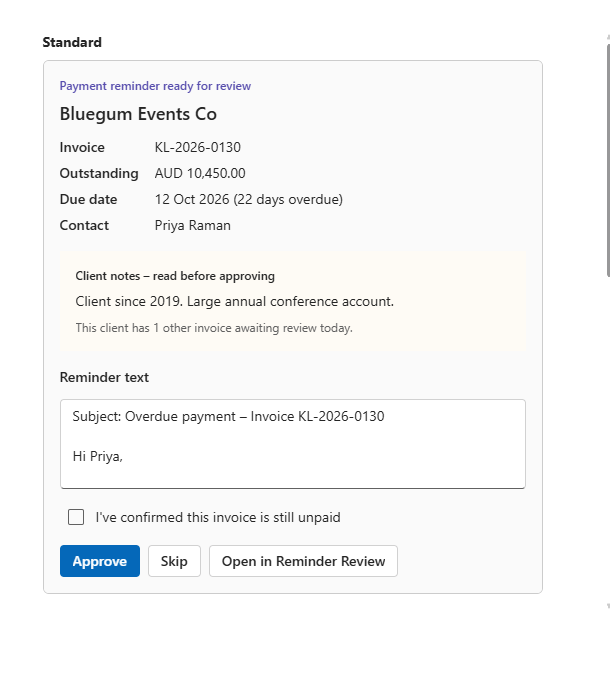

# Reminder Review app

The human-in-the-loop step: nothing the agent drafts goes anywhere until a person approves it here.

**Built with:** Copilot Studio App (preview), generated from the written brief below. It uses the existing Reminder Log table; no new tables, and no email sending.

## What it does (version 2)

- **Payment reminders** screen with two tabs and counts:
  - **Ready to send:** drafts written by the agent. Opens a detail screen.
  - **Handle personally:** cases where the agent deliberately wrote nothing (queried, promised date missed, sensitive client, final notice already sent), with the reason and a "Mark as handled" button.
- **Detail screen:** one editable "Reminder text" box, starting from the agent's draft. "See original draft" appears only once the text has been changed.
- **One Approve button:** saves the text to Edited text and records Decision = Edited if the text changed, otherwise Approved. Skip stays. Approve asks "Have you confirmed this invoice is still unpaid?" first.
- The agent's original draft is never overwritten, so edits can be measured.

## Version 1 → version 2: design review

Version 1 was generated straight from the brief below and worked, but it was built around the system rather than the reviewer:

| Version 1 | Problem | Version 2 |
|---|---|---|
| Three-step process banner ("Review queue → Invoice check → Decision") | The user doesn't need to see how it works | Removed |
| "KL-2026-0123 \| Gentle \| 14/10/2026" reference as the title | Internal key, unreadable | Invoice number (client name next) |
| Stage and prompt version on screen | Internal logic | Hidden; still stored |
| "Validation passed" column | Drafts that fail are blocked, so drafts always showed Yes; escalations showed No, which looked like an error | Removed |
| Drafts and escalations in one table | Half the rows had a blank escalation reason | Two tabs: Ready to send / Handle personally |
| Read-only draft and editable copy side by side | Same text twice | One editable box; original kept in the data |
| Approve and Approve with edits | Two buttons for one decision | One Approve; the app works out whether it was edited |

## Where this would live in a real deployment

A small-business owner wouldn't open an app every morning. In production, a daily Teams or Outlook message ("4 reminders ready, 6 to handle personally") with approve buttons would be the main way in, and this app would be the full view behind it. The sandbox tenant has no Teams or Exchange licence, so the demo uses the app.

## Brief used to generate it

```
Build a simple review app for an office manager, using the existing Dataverse table "Reminder Log" (lpc_reminderlog) in this environment. Do not create new tables.

Screen 1 – Review queue: a list of Reminder Log rows where Decision is Pending, newest first. Show Reminder reference, Stage, Validation passed and Escalation reason. Rows with an Escalation reason should be visually marked as "Escalated – owner to handle".

Screen 2 – Review detail: for the selected row, show Reminder reference, the related Invoice, Stage, Draft text (read-only), Escalation reason and Prompt version. Include an editable "Edited text" box pre-filled with Draft text.

Buttons on Screen 2:
- Approve: set Decision to Approved and save.
- Approve with edits: save Edited text, set Decision to Edited and save.
- Skip: set Decision to Skipped and save.
After any button, return to Screen 1.

Before Approve or Approve with edits, show a confirmation: "Have you confirmed this invoice is still unpaid?" with Yes and Cancel.

Do not send any email from the app.
```

## Gap found in testing

The detail screen doesn't show the client's notes, so a reviewer approved a reminder to the hardship client that the agent should have escalated.

**Fixed:** the app builder couldn't add the Invoice and Client tables in its session ("live-data connectivity isn't enabled", even when given the exact schema). Instead, formula columns on the Reminder Log bring in client name, outstanding amount, currency, due date, contact name and client notes (see [data model](../docs/data-model.md)), so the app shows them from the one table it already uses. Both tabs group invoices by client. The detail screen shows the client name as its title, the facts and a highlighted "Client notes – read before approving" box. "Handle personally" rows open a detail screen with a "What did you do?" note. The amount shown is the outstanding balance, not the invoice total, so it matches the draft for part-paid invoices.

## Tested (17/10/2026)

- Edited approval: Decision = Edited, the edited text saved, the original draft unchanged.
- Skip: removed from Ready to send.
- Mark as handled: removed from Handle personally.
- Approve → the SendApprovedReminder flow logged Outcome = Sent and updated the invoice.

## Production design: Teams / Outlook approval card

[`teams-approval-card.json`](teams-approval-card.json) is the Adaptive Card a reviewer would receive in Teams or Outlook in a real deployment: client, outstanding amount, due date, client notes (with a note when the same client has other invoices waiting), the editable reminder text, an "I've confirmed this invoice is still unpaid" tick box, and Approve / Skip buttons. It's sample data for one invoice; a Power Automate flow would fill it from the Reminder Log and post it with "Post adaptive card and wait for a response", then write the decision back. Not run live, because the sandbox tenant has no Teams or Exchange licence; previewed in the Adaptive Cards Designer:



## Found in review: one email per client

Bluegum Events Co has two drafts in the queue. Approving both would send the same contact two chasing emails on the same day. The app now groups invoices by client, but the real fix is in the agent: **v2 should draft one combined reminder per client**, which changes the rules (group by client), the drafting (several invoices, possibly at different stages) and the fact check (validate every invoice in the email).
